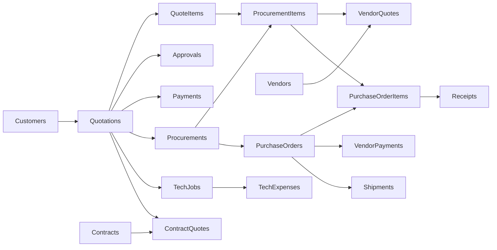

# ความสัมพันธ์และสิทธิ์

ทุกตารางใช้ id (UUID), version, createdAt, updatedAt รหัสเอกสารเป็นอีกคอลัมน์ ไม่ใช้เลขแถวเป็นรหัส

Attachments เชื่อมผ่าน entity + entityId ไป Quotations, Procurements หรือ TechJobs ไฟล์จริงอยู่ Drive ส่วนตัว ดาวน์โหลดโดยตรวจสิทธิ์เหมือน record เจ้าของ

## เปลี่ยนจากระบบเดิม

| ระบบเดิม                                 | ระบบใหม่                                                                  |
| ---------------------------------------- | ------------------------------------------------------------------------- |
| Settings: DealStatus\_<quoteId>.techJobs | TechJobs หนึ่งแถวต่องาน อ้าง quoteId                                      |
| techJobs[].expenses                      | TechExpenses อ้าง jobId                                                   |
| DealStatus\_<quoteId>.notes              | DealNotes อ้าง quoteId                                                    |
| Procurements JSON ทั้งบริษัท             | Procurements และ ProcurementItems แยกแถว                                  |
| Purchase\_<id> stageData                 | VendorQuotes, PurchaseOrders, VendorPayments, Shipments, Receipts         |
| PurchaseStatus\_<quoteId>                | แสดงทุก Procurements ของ quoteId โดยตรง ไม่ใช้สถานะสรุปใบเดียวเขียนทับกัน |
| จับคู่ต้นทุนจากชื่อสินค้า                | ProcurementItems.quoteItemId และ PurchaseOrderItems.procurementItemId     |
| สัญญา quoteId คั่น comma                 | ContractQuotes หนึ่งแถวต่อความสัมพันธ์                                    |
| Vendors array                            | Vendors หนึ่งแถวต่อผู้ขาย                                                 |

นี่เป็นการรักษาความสัมพันธ์สำหรับรายการใหม่ ไม่ใช่ mapping สำหรับนำเข้าข้อมูลเก่า

## สิทธิ์เริ่มต้น

| บทบาท    | ขอบเขต                                                                           |
| -------- | -------------------------------------------------------------------------------- |
| Admin    | ตั้งค่าทั้งหมด เห็นทุกโมดูล แต่การอนุมัติต้องเป็นผู้ถูกมอบหมายและไม่ใช่เจ้าของใบ |
| Sales    | ลูกค้า ใบเสนอราคาของตน ส่งจัดซื้อ มอบหมายช่าง รับเงินและติดตามงานที่เชื่อม       |
| Approver | อ่านงานขายทั้งหมด อนุมัติเฉพาะใบที่ระบุอีเมลตน                                   |
| Purchase | สินค้า/ผู้ขาย งานจัดซื้อ ราคา PO จ่ายเงิน ขนส่งและตรวจรับ                        |
| Tech     | เฉพาะงานช่างที่มอบหมายให้ตน สถานะ ค่าใช้จ่ายและไฟล์ของงาน                        |
| Finance  | งานขายและยอดชำระ งานจัดซื้อเพื่อจ่ายผู้ขาย และสัญญา                              |

บทบาทรวมกันได้ หากต้องแยกทีม/สาขาหรือซ่อนต้นทุนจากฝ่ายขาย ต้องเพิ่มนโยบายก่อนใช้จริง ปัจจุบันฝ่ายขายเห็นรายละเอียดจัดซื้อที่เชื่อมกับงานตน เหมือนการติดตามต้นทุนร่วมในระบบเดิม

## การเขียนและความถูกต้อง

- ตรวจ session กับ active user ใหม่ทุก RPC; ไม่รับ role/email ผู้ทำรายการจาก payload
- ตรวจสถานะก่อนเปลี่ยนขั้น ตรวจ reference และจำนวนสั่ง/รับ/จ่าย
- ตรวจ version เมื่อแก้ record ที่มีอยู่; new child record ตรวจยอดคงเหลือใน lock เดียวกัน
- requestId ต่อผู้ใช้ ป้องกัน retry สร้างซ้ำ ถ้าใช้ id เดิมกับ payload ต่างกันจะปฏิเสธ
- ใช้ Sheets updateCells แบบระบุ stringValue จึงไม่ตีความข้อความที่ขึ้นต้น = เป็นสูตร
- บันทึกตารางธุรกิจ AuditLog และ Requests ในหนึ่ง atomic batch; ข้อมูลใน Drive เป็นอีกบริการ มีขอบเขต transaction แยกกัน

## ส่วนเพิ่มรุ่น 0.2

- CustomerCredits / CustomerRefunds → quoteId; ยอดคงเหลือ = total - credits - payments(รวม withholding) + refunds
- PurchaseReturns → purchaseOrderId + purchaseOrderItemId; VendorRefunds → purchaseOrderId
- RFQs → procurementId + vendorId + itemIds; Documents → quoteId / purchaseOrderId / paymentId / rfqId พร้อม snapshot
- ApprovalRules กำหนดวงเงินและผู้อนุมัติ; Settings เก็บตัวเลือก workspace
- Attachments เพิ่ม Company / Vendors และ relatedTable + relatedId สำหรับ Payments, VendorPayments, TechExpenses, Receipts, RFQs โดยตรวจว่าอยู่ใต้ entity เดียวกัน
- Outbox เก็บ dedupeKey และสถานะ pending/sending/sent/uncertain/cancelled; BackupLog เก็บผลสำรอง
- Quotations.revisionOf อ้างใบเดิมโดยไม่ลบรายการเดิม
